# Análises — campanha individual de Miguel Bertonzin

As quatro coletas são da ESP32 própria de Miguel. Logs brutos, hashes, CSV e fontes estão preservados. Nenhuma amostra foi descartada. Na etapa 2, o registro documenta um prefixo de boot separado somente para leitura; o arquivo bruto permanece intacto.

## Convenções

D fixo = 32.440,800 µs, calculado como 1,2 × HWM1. Cumpre em R ≤ D; perde em R > D. HWM99 remove floor(N/100) valores do topo e toma o maior restante. S é a menor distância entre perdas; fica indefinido com menos de duas. Rajada tem pelo menos duas perdas consecutivas. São avaliadas todas as N−k+1 janelas completas; m = k − máximo de perdas.

## Resultados

| Etapa | N | Mín. µs | Média µs | HWM µs | HWM99 µs | Prazo % | S | k=10 | k=20 | k=50 |
| --- | --- | --- | --- | --- | --- | --- | --- | --- | --- | --- |
| 1 | 1000 | 26.818,000 | 26.864,804 | 27.034,000 | 26.898,000 | 100,000 | — | (10,10) | (20,20) | (50,50) |
| 2 | 1000 | 26.844,000 | 26.891,429 | 27.148,000 | 26.924,000 | 100,000 | — | (10,10) | (20,20) | (50,50) |
| 3 | 1000 | 26.855,000 | 28.693,667 | 39.962,000 | 39.948,000 | 82,100 | 2 | (7,10) | (16,20) | (40,50) |
| 4 | 10000 | 26.893,000 | 28.906,517 | 40.304,000 | 40.094,000 | 82,140 | 2 | (7,10) | (16,20) | (40,50) |

### Etapa 1

Perdas: 0; isoladas: 0; rajadas: 0; maior rajada: 0. Mediana: 26.865,000 µs; desvio padrão populacional: 15,680 µs.

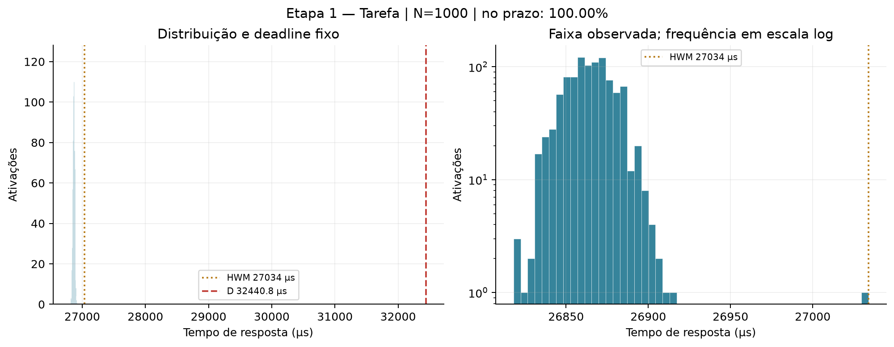

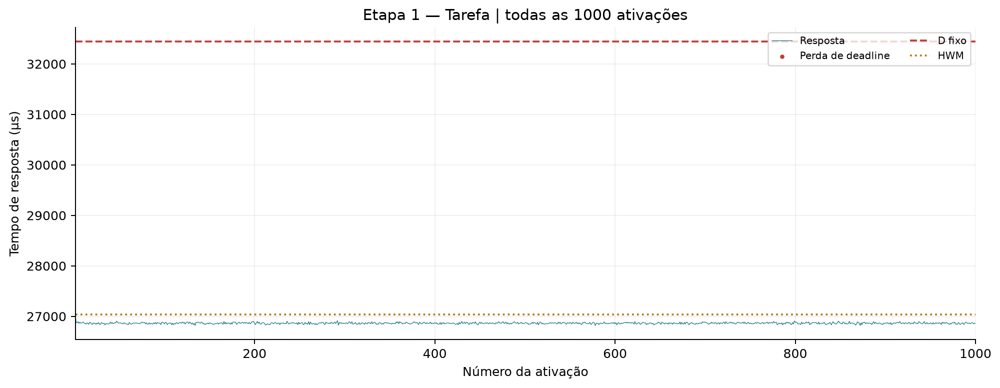

Listas integrais: etapa1/perdas.csv, distancias.csv, sequencias_perdas.csv e janelas_k10/k20/k50.csv.

### Etapa 2

Perdas: 0; isoladas: 0; rajadas: 0; maior rajada: 0. Mediana: 26.891,000 µs; desvio padrão populacional: 16,826 µs.

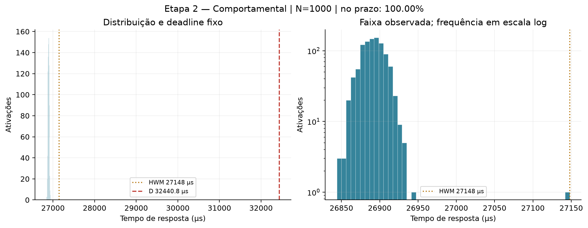

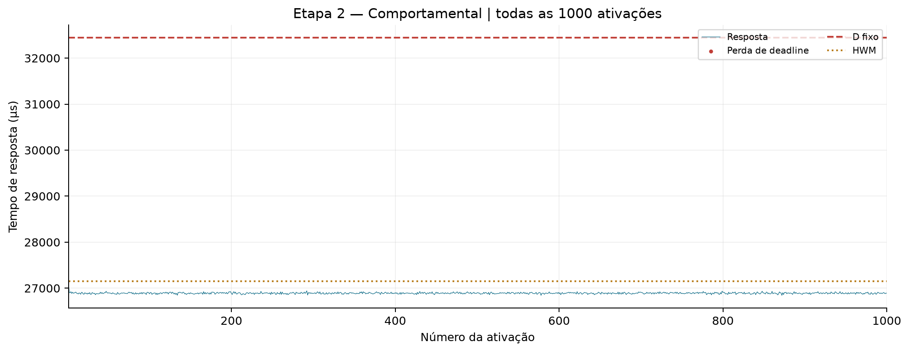

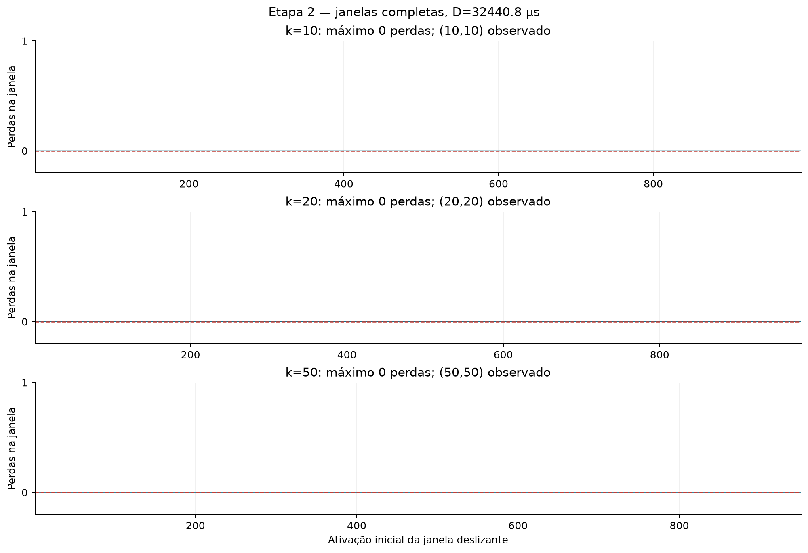

Listas integrais: etapa2/perdas.csv, distancias.csv, sequencias_perdas.csv e janelas_k10/k20/k50.csv.

### Etapa 3

Perdas: 179; isoladas: 179; rajadas: 0; maior rajada: 0. Mediana: 26.906,000 µs; desvio padrão populacional: 3.977,561 µs.

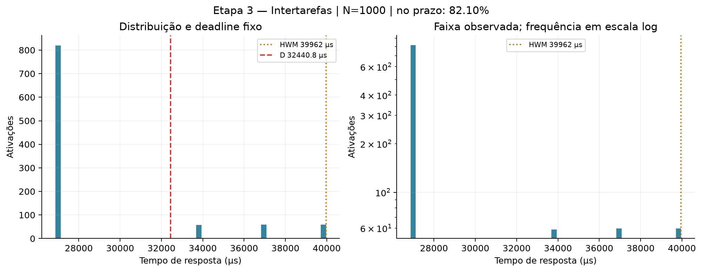

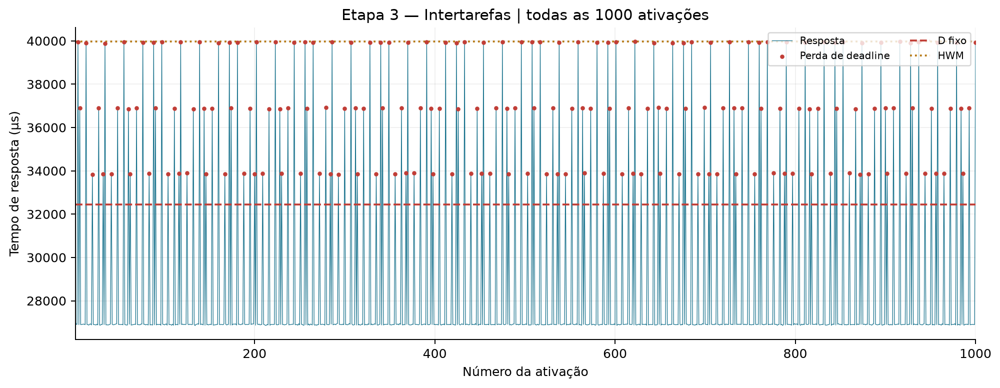

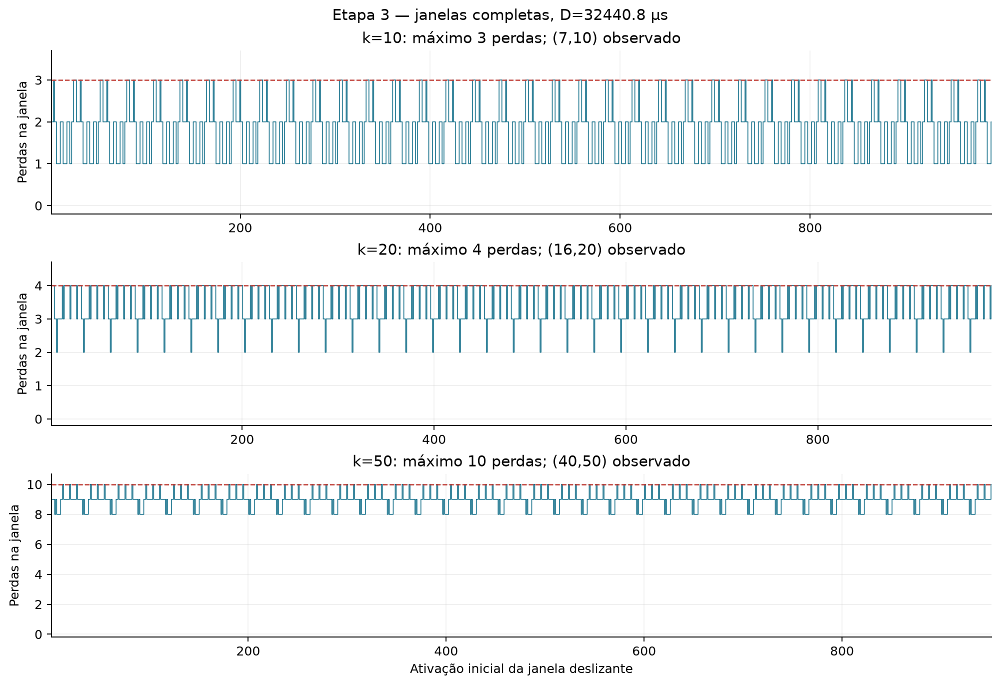

Listas integrais: etapa3/perdas.csv, distancias.csv, sequencias_perdas.csv e janelas_k10/k20/k50.csv.

### Etapa 4

Perdas: 1786; isoladas: 1786; rajadas: 0; maior rajada: 0. Mediana: 26.970,000 µs; desvio padrão populacional: 3.997,673 µs.

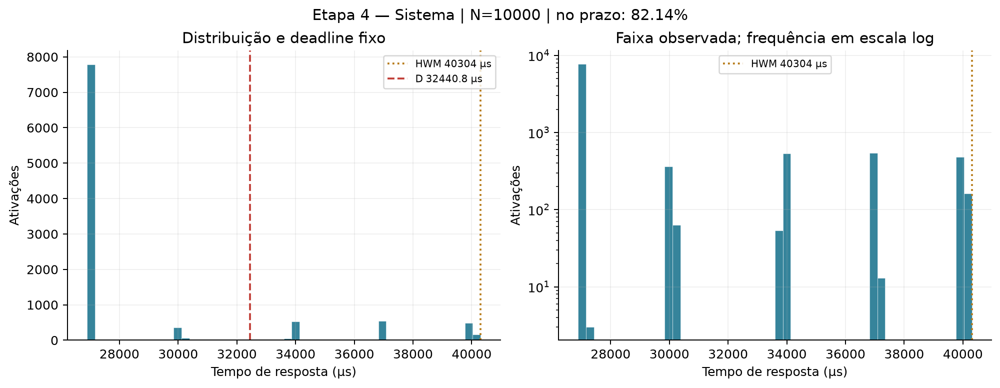

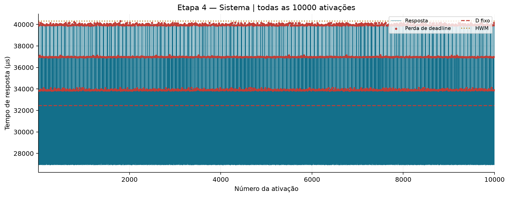

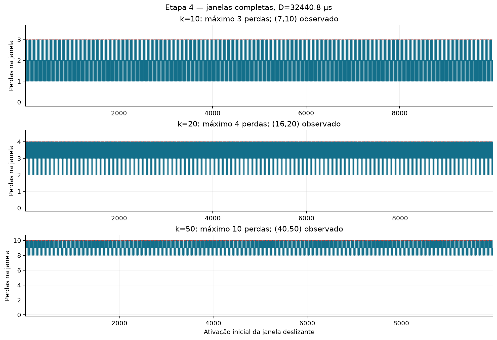

Listas integrais: etapa4/perdas.csv, distancias.csv, sequencias_perdas.csv e janelas_k10/k20/k50.csv.

## A — cobertura e HWM

Nova execução de gcov: 98.89% das linhas e 98.75% dos resultados de desvio do algoritmo no computador. A proteção contra overflow não é alcançável pelos limites de entrada da suíte nessa plataforma. Não houve marco de 100%. O mesmo algoritmo tem HWMs diferentes conforme o contexto; cobertura de linhas/desvios não esgota estados temporais, nem representa todos os caminhos.

## B — convergência

| Amostras | HWM µs | Abaixo do HWM final % |
| --- | --- | --- |
| 10 | 40.164,000 | 0,347 |
| 20 | 40.164,000 | 0,347 |
| 100 | 40.164,000 | 0,347 |
| 1000 | 40.217,000 | 0,216 |
| 10000 | 40.304,000 | 0,000 |

O último aumento ocorreu na ativação 1798. Os patamares e a subestimação dos prefixos descrevem a amostra, sem demonstrar WCRT. A cronologia completa está em etapa4/saltos_hwm.csv.

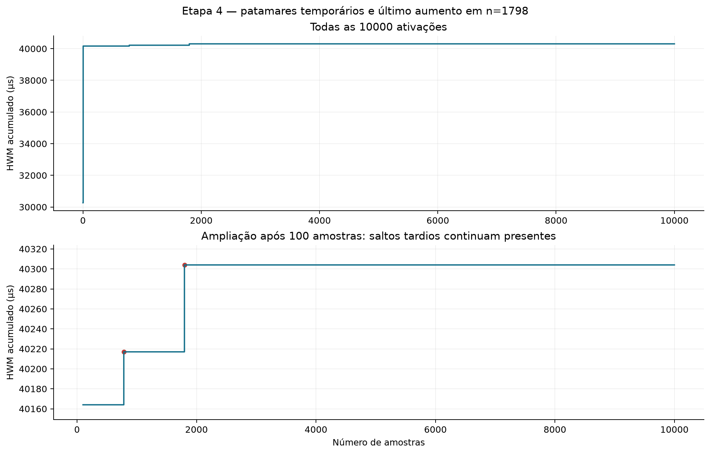

## C — margens

| Margem % | Limite µs | Primeira etapa insuficiente |
| --- | --- | --- |
| 10 | 29.737,400 | 3 |
| 25 | 33.792,500 | 3 |
| 50 | 40.551,000 | nenhuma observada |

Margem necessária para cobrir somente o HWM4 observado: 49,086%. Maior variabilidade exige reavaliar a margem; cobrir os máximos desta campanha não garante execuções futuras.

## D — deadlines alternativos

| Etapa | Escolha | D µs | Prazo % | S | (m,20) | Isoladas | Rajadas | Maior rajada |
| --- | --- | --- | --- | --- | --- | --- | --- | --- |
| 3 | HWM etapa 1 | 27.034,000 | 82,000 | 2 | (15,20) | 180 | 0 | 0 |
| 3 | Intermediário | 33.564,000 | 82,100 | 2 | (16,20) | 179 | 0 | 0 |
| 3 | HWM99 etapa 4 | 40.094,000 | 100,000 | — | (20,20) | 0 | 0 | 0 |
| 3 | D fixo | 32.440,800 | 82,100 | 2 | (16,20) | 179 | 0 | 0 |
| 3 | Mínimo (18,20) | 39.960,000 | 99,800 | 294 | (19,20) | 2 | 0 | 0 |
| 4 | HWM etapa 1 | 27.034,000 | 66,870 | 1 | (7,20) | 1379 | 526 | 11 |
| 4 | Intermediário | 33.564,000 | 82,140 | 2 | (16,20) | 1786 | 0 | 0 |
| 4 | HWM99 etapa 4 | 40.094,000 | 99,000 | 2 | (18,20) | 100 | 0 | 0 |
| 4 | D fixo | 32.440,800 | 82,140 | 2 | (16,20) | 1786 | 0 | 0 |
| 4 | Mínimo (18,20) | 39.960,000 | 97,140 | 2 | (18,20) | 286 | 0 | 0 |

A meta (18,20) é ilustrativa. O menor D observado é 39.960,000 µs; o valor distinto anterior, 39.957,000 µs, falha. A redução frente ao HWM100 é 344,000 µs. O cálculo toma o máximo dos 18º menores tempos das janelas de 20. As listas completas para os cinco deadlines estão em experimento_d/.

Percentual global não caracteriza o espaçamento das perdas. Para uma planta com inércia, perdas isoladas e longas rajadas podem ter efeitos diferentes. S e (m,k) descrevem a concentração, mas não validam fisicamente uma tolerância.

## Limitações e reprodução

Uma campanha por cenário, semente e tamanho; N diferente entre etapas; jitter antes do envio excluído; cache, interrupções e processos do computador não rastreados. Cobertura é do algoritmo no computador. ESP-IDF v6.1-dirty aparece na nova campanha. O volume UART real deve ser consultado em dados/etapa4/evidencias/validacao.json. HWM e (m,k) são observados, sem garantia futura.

Executar scripts/analisar_coletas.py dentro desta campanha. O relatório de oito páginas é montado por scripts/gerar_relatorio.py.
