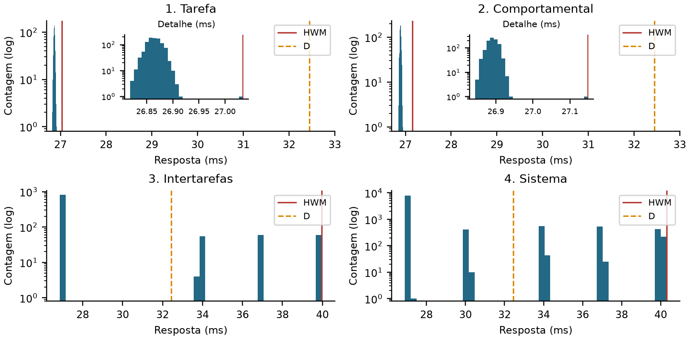
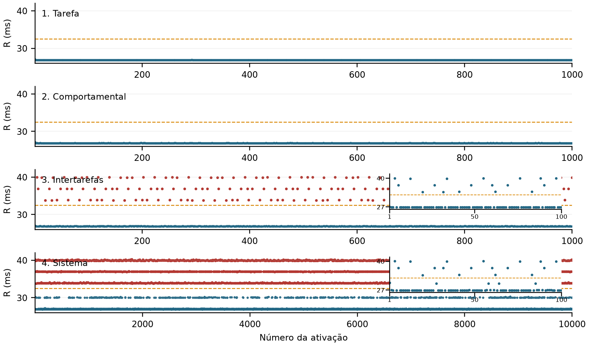
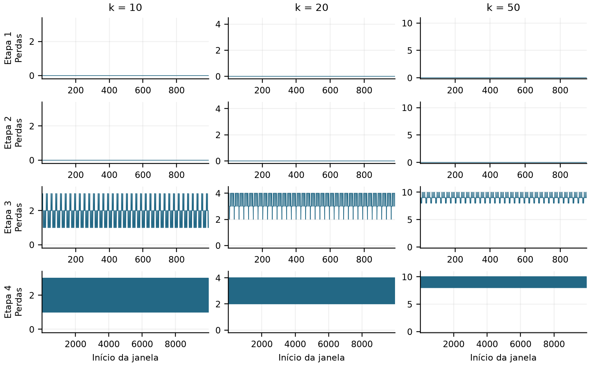
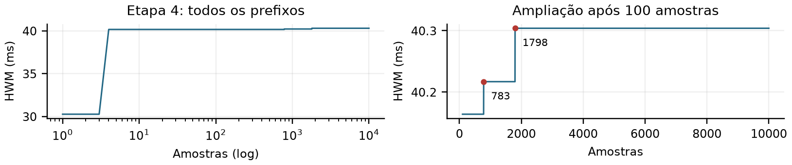
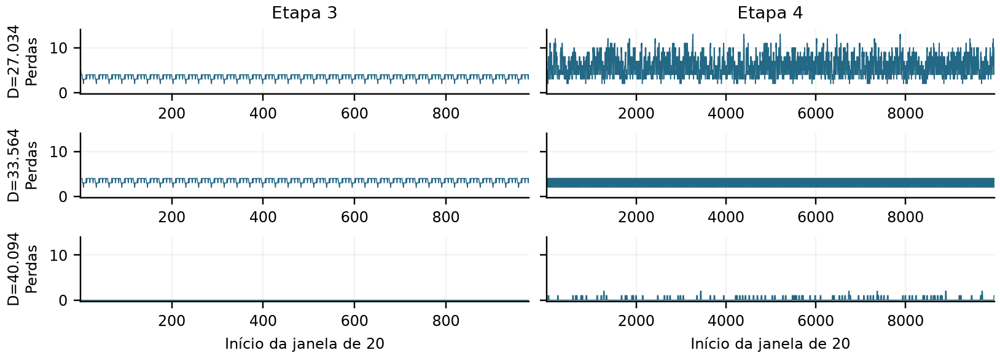

# Quanto o teste enxerga do pior caso?

## Codificação de Huffman na ESP32

**Universidade do Vale do Itajaí — UNIVALI | Escola Politécnica**

Engenharia de Computação · Sistemas em Tempo Real · Atividade complementar M3 · 2026

**Acadêmico:** Miguel Bertonzin — RA: [PREENCHER].

**Professores:** Michael Douglas Cabral Alves e Felipe Viel.

**Repositório:** https://github.com/MiguelBertonzin/measurements-in-real-time-systems

## 1. Objetivo, plataforma e metodologia

O objetivo é medir a mesma tarefa Huffman em quatro escopos e investigar por que o máximo observado (HWM) depende da concorrência, mesmo com a lógica já exercitada [1]. HWM é uma aproximação potencialmente otimista do WCRT, não um limite provado. A campanha reúne 13.000 ativações reais e examina perdas de prazo por percentual, distância e janelas (m,k)-firme.

**Plataforma.** ESP32-D0WD-V3, revisão 3.1, dois núcleos, cristal de 40 MHz, CPU fixa em 160 MHz e FreeRTOS/ESP-IDF v6.1-dirty; tick de 100 Hz, otimização de debug e gerenciamento dinâmico de energia desabilitado. Huffman e cargas usam o núcleo 0; tarefas internas e o segundo núcleo continuam ativos. Wi-Fi desativado; não há governor Linux. O computador Windows usa PowerShell, Python e ESP-IDF/VS Code; na etapa 4, o monitor fica fechado e o coletor ocupa a COM7. O inventário dos demais processos do computador não foi registrado.

**Entrada e medição.** Código C, array de 4.096 bytes ASCII (32–126), xorshift32 com semente 123456789; o estado avança entre ativações e reinicia no boot. Cada execução codifica, decodifica e compara a saída com a entrada. Usa-se clock_gettime(CLOCK_MONOTONIC); geração da entrada e impressão ficam fora do intervalo. Os resultados ficam em RAM e são impressos ao final como ativacao,tempo_us. Todas as amostras passaram na validação.

**Deadline e critério comum.** D = 1,2 × HWM1 = **32.440,8 µs**, fixado após a etapa 1 e mantido nas quatro etapas. A margem de 20% é uma hipótese experimental. Cumpre o prazo se R ≤ D; perde se R > D. Exigem-se índices completos, tempos positivos e nenhuma falha funcional. Picos não são descartados. Apenas o experimento D altera o limiar.

### 1.1 Etapas: caso, procedimento e critério

**1 — Tarefa. Caso:** Huffman isolado, 1.000 ativações e um tick de intervalo, fora da medição. **Procedimento:** compilar dados/etapa1/fontes, gravar, reiniciar e capturar até o fim; medir preparação do workspace, codificação, decodificação e validação. **Critério:** reconstrução exata; obter HWM1 e definir D.

**2 — Comportamental. Caso:** 1.000 eventos externos à tarefa, simulados por fila, um pedido por vez; Huffman com prioridade 1. **Procedimento:** compilar/gravar a etapa 2; enviar, aguardar confirmação e esperar um tick. Medir do envio efetivo ao término da validação. **Critério:** todos os eventos atendidos corretamente; avaliar despacho e prazo fixo. Não se trata de interrupção física de GPIO.

**3 — Intertarefas. Caso:** Huffman (100 ms, prioridade 1), buffer (70 ms, prioridade 1) e CPU (30 ms, prioridade 2). O buffer compartilha mutex com Huffman, escreve 128 bytes e retém o recurso por um tick; a cada oitavo trabalho, dois ticks. A CPU ocupa 3 ms de tempo de parede. **Procedimento:** compilar/gravar, iniciar cargas, estabilizar por 100 ms e coletar 1.000 eventos periódicos. **Critério:** corretude e cargas ativas; buscar perdas por contenção e preempção, incluídas na resposta até liberar o mutex.

**4 — Sistema. Caso:** etapa 3 com 10.000 ativações e recepção UART0 (115.200 baud, prioridade 3), com checksum sem eco. **Procedimento:** compilar/gravar, fechar o monitor e executar scripts/coletar_sistema.py --porta COM7; enviar 128 bytes a cada 20 ms durante 1 s, com pausa de 2 s; aguardar cerca de 1.000 s e o CSV. **Critério:** validação completa, tráfego recebido e cargas ativas. A UART acrescenta interrupções e processamento mais prioritário; os períodos diferentes variam as fases de concorrência.

<!-- pagina -->
## 2. Estatísticas e distribuição dos tempos

**Tabela 1 — Síntese com D = 32.440,8 µs.** Tempos em µs. HWM99 é o máximo após retirar exatamente os floor(N/100) maiores valores: 10 nas etapas 1–3 e 100 na etapa 4. Não é percentil interpolado; as demais análises mantêm todas as amostras.

| Etapa | Cob. L/D (%) | Mín. | Média | HWM100 | HWM99 | Prazo (%) | S | k=10 | k=20 | k=50 |
| --- | --- | --- | --- | --- | --- | --- | --- | --- | --- | --- |
| 1. Tarefa | 98,89 / 98,75 | 26.818 | 26.864,804 | 27.034 | 26.898 | 100,00 | — | (10,10) | (20,20) | (50,50) |
| 2. Comportamental | 98,89 / 98,75 | 26.844 | 26.891,429 | 27.148 | 26.924 | 100,00 | — | (10,10) | (20,20) | (50,50) |
| 3. Intertarefas | 98,89 / 98,75 | 26.855 | 28.693,667 | 39.962 | 39.948 | 82,10 | 2 | (7,10) | (16,20) | (40,50) |
| 4. Sistema | 98,89 / 98,75 | 26.893 | 28.906,517 | 40.304 | 40.094 | 82,14 | 2 | (7,10) | (16,20) | (40,50) |

**Nota:** cobertura L/D = linhas/resultados de desvio de huffman.c, medida com gcov no computador. É comum às etapas porque os fontes coincidem; não representa cobertura de cada firmware na ESP32. S é expresso em ativações; “—” indica ausência de duas perdas.

Nas etapas 1–2, a maioria dos tempos está próxima das medianas de 26.865 e 26.891 µs. Os desvios padrão populacionais são 15,68 e 16,83 µs; poucos valores maiores estendem a cauda à direita. HWM−HWM99 vale 136 e 224 µs, sem alcançar D.

Nas etapas 3–4, as medianas continuam próximas (26.906 e 26.970 µs), mas os desvios padrão chegam a 3.977,56 e 3.997,67 µs. Aparecem grupos próximos de 27, 30, 34, 37 e 40 ms. A distribuição não é apenas uma cauda longa e fina: há modos elevados recorrentes. HWM−HWM99 vale 14 e 210 µs. A média sozinha não revela essa estrutura nem as perdas.

<!-- pagina -->
## 3. Evolução temporal, perdas e skip factor

O HWM cresce pouco entre tarefa isolada e atendimento de evento: 27.034 para 27.148 µs. Com concorrência chega a 39.962 µs; no sistema com UART, a 40.304 µs. Nas etapas 1–2, o máximo ocorreu na primeira ativação, mas um possível efeito de primeira execução não foi instrumentado. Na etapa 4, os pontos densos parecem faixas; os índices mostram perdas isoladas e recorrentes no D fixo.

| Etapa | N | Perdas | Prazo (%) | Isoladas | Rajadas | Maior seq. | S |
| --- | --- | --- | --- | --- | --- | --- | --- |
| 1 | 1.000 | 0 | 100,00 | 0 | 0 | 0 | — |
| 2 | 1.000 | 0 | 100,00 | 0 | 0 | 0 | — |
| 3 | 1.000 | 179 | 82,10 | 179 | 0 | 1 | 2 |
| 4 | 10.000 | 1.786 | 82,14 | 1.786 | 0 | 1 | 2 |

**Tabela 2 — Perdas com D fixo.** Sequência máxima de tamanho 1 é isolada; rajada tem pelo menos duas perdas consecutivas. “Maior seq.” inclui isoladas. Para índices p em ordem, S = mínimo(p[j+1] − p[j]).

Nas etapas 3–4, as primeiras perdas são **4, 6, 13, 20, 27, 32, 34, 41, 48, 55, 60, 62, 69, …**, com distâncias **2, 7, 7, 7, 5, 2, 7, 7, 7, 5, 2, 7, …**. S = 2 significa ao menos uma ativação cumprida entre perdas consecutivas da amostra; não é uma duração em milissegundos.

As listas integrais estão em analises/etapaN/perdas.csv, distancias.csv e sequencias_perdas.csv. Sem perdas, esses CSV contêm apenas cabeçalho. A etapa 3 registrou 1.431 trabalhos de buffer, 3.338 de CPU e 179 contenções; na 4, foram 14.288, 33.339 e 1.786, além de 9.524 leituras e 1.342.958 bytes UART. Contadores de atraso do gerador/cargas foram zero; isso não mede todo jitter nem prova a causa de cada perda.

<!-- pagina -->
## 4. Análise específica de (m,k)-firme

Uma exigência (m,k)-firme requer pelo menos m prazos cumpridos em **qualquer** janela de k ativações consecutivas. Para k ∈ {10, 20, 50}, percorremos todas as N−k+1 janelas completas, avançando uma ativação por vez. Se L(i,k) conta as perdas, m = k − máximo L(i,k). Não há janelas circulares ou preenchimento das bordas.

Nas etapas 1–2, nenhuma janela contém perda: os pares são **(10,10), (20,20) e (50,50)**. Nas etapas 3–4, as piores janelas têm 3, 4 e 10 perdas, resultando em **(7,10), (16,20) e (40,50)**. A janela [1,20] já contém as perdas 4, 6, 13 e 20, testemunhando o limite de quatro perdas.

Todas as janelas estão em janelas_k10.csv, janelas_k20.csv e janelas_k50.csv na pasta de análise de cada etapa. Ter 82,14% globalmente no prazo não assegura esse percentual em todo intervalo curto. (16,20) fornece uma restrição local verificável; os três pares não são intercambiáveis, pois uma janela de 50 não descreve sozinha a concentração em 10.

**Limite:** os pares caracterizam as janelas medidas. Não são prova de escalonabilidade, garantia futura ou validação da estabilidade de uma planta física. O mesmo percentual global pode corresponder a agrupamentos muito diferentes de perdas.

<!-- pagina -->
## 5. Experimentos A, B e C

### 5.1 A — Cobertura e HWM

GCC/gcov 8.1.0 no Windows, com -O0 e --coverage, registrou **89/90 linhas (98,89%) e 79/80 resultados de desvio (98,75%)** de main/huffman.c. Os testes incluem entrada vazia, símbolo único, 256 símbolos, códigos longos, 1.000 entradas pseudoaleatórias, vetor conhecido e erros. “Branches executed = 100%” significa decisões alcançadas, não todos os resultados tomados.

O único resultado ausente é o retorno de overflow da linha 131. Com 256 símbolos, os códigos têm até 255 bits e a API limita a entrada a UINT32_MAX. No teste de 64 bits, 255 × (2^32 − 1) < 2^64 − 1: a soma não transborda size_t. Para a ESP32, 4.096 × 255 = 1.044.480 < 2^32 − 1. A proteção foi mantida. Essa é a justificativa de impossibilidade admitida no enunciado, não uma alegação de 100%.

**Não existe marco de cobertura 100% ao qual associar um HWM.** A cobertura é separada da placa, sobre o mesmo módulo. Os HWMs 27.034, 27.148, 39.962 e 40.304 µs crescem sem alterar o algoritmo. Linhas/desvios não enumeram caminhos completos, cache, interrupções ou fases de disputa; cobertura funcional não esgota os estados temporais.

### 5.2 B — Convergência

| N | 10 | 20 | 100 | 1.000 | 10.000 |
| --- | --- | --- | --- | --- | --- |
| HWM (µs) | 40.164 | 40.164 | 40.164 | 40.217 | 40.304 |

**Tabela 3 — Prefixos da mesma coleta.** Com 10 ou 20 amostras, o máximo parece 0,347% menor que o final. O patamar de 40.164 µs dura da ativação 4 à 782; na 783 sobe para 40.217 µs e, na 1.798, para 40.304 µs. Depois parece estável nessa amostra, mas não se comprova convergência ao WCRT.

### 5.3 C — Margens de segurança

| Margem | Limite (µs) | HWM4 − limite (µs) | Primeira etapa insuficiente |
| --- | --- | --- | --- |
| 10% | 29.737,4 | 10.566,6 | 3 |
| 25% | 33.792,5 | 6.511,5 | 3 |
| 50% | 40.551,0 | -247,0 | Nenhuma observada |

**Tabela 4 — Margens sobre HWM1.** As de 10% e 25% falham na etapa 3. A de 50% cobre as quatro coletas, com folga de 247 µs na última. Cobrir HWM4 exigiria 49,0863%, sem garantia futura. Como no exemplo de 12–14 ms versus 10–16 ms da aula [2], maior dispersão muda a incerteza; não basta manter uma margem fixa quando o contexto temporal muda.

<!-- pagina -->
## 6. Experimento D: deadlines alternativos

Reprocessamos as etapas 3–4 com cinco valores: HWM1; D fixo; intermediário (27.034 + 40.094)/2 = 33.564 µs; HWM99 da etapa 4; e o mínimo da meta (18,20). A meta é **ilustrativa**, pois não foi dada uma tolerância física. Os CSV de analises/experimento_d repetem integralmente perdas, distâncias, rajadas e janelas k = 10/20/50.

| Etapa | D (µs) | Prazo (%) | S | k=10 | k=20 | k=50 | I/R/M |
| --- | --- | --- | --- | --- | --- | --- | --- |
| 3 | 27.034 | 82,00 | 2 | (7,10) | (15,20) | (40,50) | 180/0/0 |
| 3 | 33.564 | 82,10 | 2 | (7,10) | (16,20) | (40,50) | 179/0/0 |
| 3 | 40.094 | 100,00 | — | (10,10) | (20,20) | (50,50) | 0/0/0 |
| 3 | 32.440,8 | 82,10 | 2 | (7,10) | (16,20) | (40,50) | 179/0/0 |
| 3 | 39.960 | 99,80 | 294 | (9,10) | (19,20) | (49,50) | 2/0/0 |
| 4 | 27.034 | 66,87 | 1 | (0,10) | (7,20) | (25,50) | 1379/526/11 |
| 4 | 33.564 | 82,14 | 2 | (7,10) | (16,20) | (40,50) | 1786/0/0 |
| 4 | 40.094 | 99,00 | 2 | (8,10) | (18,20) | (47,50) | 100/0/0 |
| 4 | 32.440,8 | 82,14 | 2 | (7,10) | (16,20) | (40,50) | 1786/0/0 |
| 4 | 39.960 | 97,14 | 2 | (8,10) | (18,20) | (46,50) | 286/0/0 |

**Tabela 5 — Deadlines em µs.** I/R/M = isoladas/número de rajadas/maior rajada (≥2). S em ativações; “—” indica ausência de duas perdas. R = D conta como cumprimento. Em D = HWM99, 99,00% cumprem na etapa 4: há 100 tempos acima do corte.

**Menor D para (18,20).** Em cada janela, toma-se o 18º menor dos 20 tempos; o máximo desses valores é o menor limiar que atende a todas. Na etapa 4, **D mínimo = 39.960 µs**, com 97,14% no prazo. O valor distinto anterior, 39.957 µs, dá três perdas na janela [3431,3450], falhando com (17,20). Frente a HWM100 = 40.304 µs, a redução é de 344 µs (0,854%).

**Isoladas versus rajadas.** Com D = 27.034 µs, a etapa 4 tem 526 rajadas, a maior com 11 perdas, e 1.379 isoladas; S = 1. No D fixo, as 1.786 perdas são isoladas e S = 2. Uma planta com inércia pode tolerar uma atualização omitida, enquanto perdas seguidas prolongam a ausência de correção. O percentual sozinho não descreve esse intervalo. A campanha não demonstra tolerância segura para um equipamento real.

<!-- pagina -->
## 7. Reprodutibilidade, limites e conclusão

### 7.1 Reprodutibilidade e evidências

Os quatro CSV foram comparados linha a linha com os logs e seus hashes. Os snapshots de firmware/sdkconfig estão em dados/etapaN/fontes; o módulo Huffman coincide nas quatro etapas e na cobertura. A comparação de prazos usa nanossegundos inteiros. Seis testes de métricas e uma implementação NumPy independente conferem 14 cenários, 42 séries de janelas e o deadline mínimo por busca binária.

Na raiz do repositório, instalar requirements-relatorio.txt e executar scripts/analisar_coletas.py, scripts/verificar_analises.py e scripts/gerar_relatorio.py. O último gera o projeto LaTeX; compilar main.tex no Overleaf produz o PDF. Os testes usam python -m unittest discover -s tests -p test_metricas.py -v. O README descreve a compilação de cada etapa. Reprocessar os CSV reproduz tabelas e gráficos; novas execuções podem gerar outros tempos.

**Entrega:** relatorio/ contém PDF, fontes LaTeX e figuras; main/, scripts/ e tests/, a implementação; dados/, CSV, logs, snapshots e gcov; analises/, estatísticas e listas/janelas integrais. O repositório está na capa; os anexos acompanham o PDF no ZIP.

### 7.2 Ameaças à validade

**Escopo e causalidade.** Na etapa 1 mede-se processamento; nas seguintes, também atendimento e contenção. Isso impede atribuir toda diferença a um único custo. A resposta começa no envio efetivo, excluindo atraso prévio do gerador. Contenções e perdas com totais iguais não provam correspondência individual. Reter mutex com espera é uma política simulada.

**Amostragem.** Há uma campanha por cenário, uma semente e um tamanho. Mais amostras favorecem máximos maiores: nas primeiras 1.000 da etapa 4, HWM = 40.217 µs e 82,10% cumprem D, contra 39.962 µs e 82,10% na etapa 3. A diferença persiste, mas não isola a UART nem substitui repetições independentes.

**Plataforma e instrumentação.** Cache, interrupções e tarefas internas não foram rastreados por ativação. Frequência fixa não elimina estados ocultos. Relógio e validação integram a medição; impressão foi adiada. Processos do computador gerador não foram totalmente controlados. ESP-IDF v6.1-dirty limita a identificação do SDK. Não se avaliaram outras arquiteturas, rede ou estresse de flash.

**Integridade.** Na etapa 2, o log bruto contém 33.340 bytes ilegíveis/mensagens ROM antes do boot completo, sem marcadores de medições. O sufixo validado contém as 1.000 ativações, sem descarte, com SHA do ELF conferido; a causa do prefixo não foi determinada. Não há rastreamento de perda de bytes UART por ativação. A cobertura não abrange o firmware inteiro.

### 7.3 Conclusão

O HWM passou de 27.034 para 40.304 µs (**+49,09%**), e as perdas no D fixo passaram de zero para 17,86%. A concorrência mudou a distribuição sem alterar Huffman. Cobertura elevada sustenta a validação funcional, mas não demonstra WCRT; saltos tardios mostram o limite de interpretar patamares como garantia.

Nas etapas 3–4, (16,20) resume o pior intervalo de 20 ativações, embora todas as perdas no D fixo sejam isoladas. A meta (18,20) requer D ≥ 39.960 µs na etapa 4. Percentual, S, rajadas e janelas descrevem juntos a tolerância observada, sem provar comportamento futuro.

### Referências

[1] UNIVALI. Atividade Complementar — Quanto o teste enxerga do pior caso. Sistemas em Tempo Real, M3. Enunciado fornecido, 6 p.

[2] UNIVALI. Estimação do Tempo de Resposta usando Medições. Aula 10, material fornecido na disciplina, 39 p.
