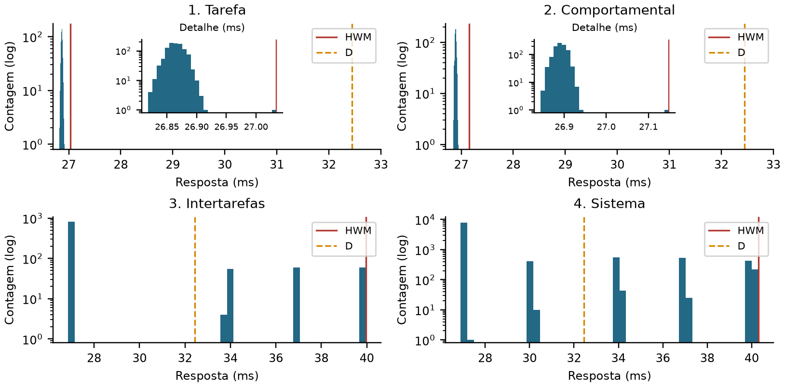
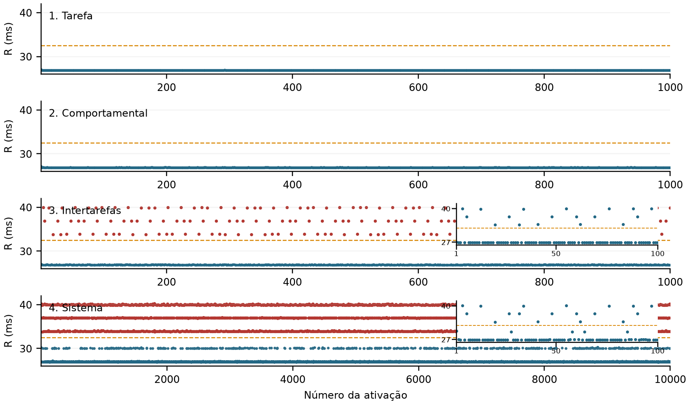
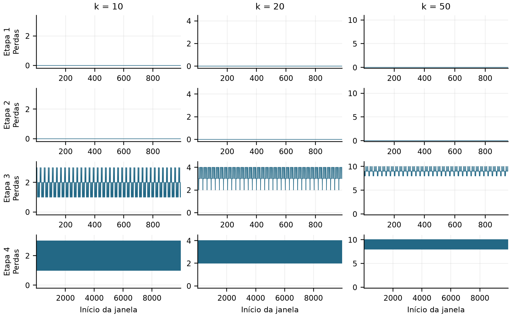
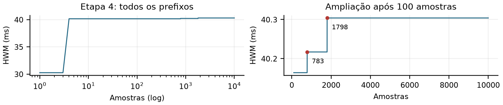
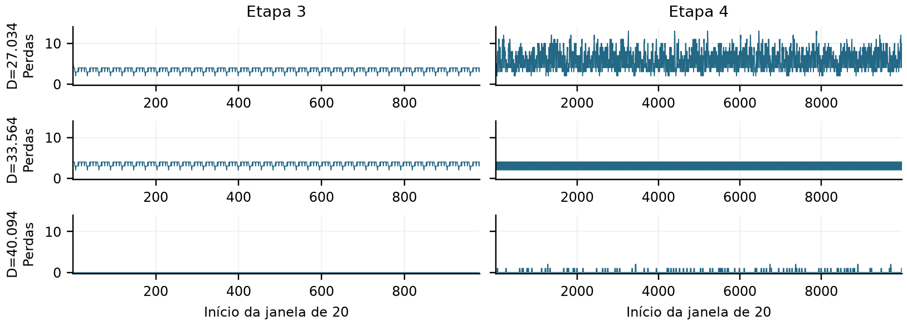

# Quanto o teste enxerga do pior caso?

## Codificação de Huffman na ESP32: quatro escopos de medição

**Universidade do Vale do Itajaí — UNIVALI | Escola Politécnica**

Engenharia de Computação · Sistemas em Tempo Real · Atividade complementar M3 · 2026

**Acadêmico:** Miguel Bertonzin — RA: [PREENCHER].

**Professores:** Michael Douglas Cabral Alves e Felipe Viel.

**Repositório:** https://github.com/MiguelBertonzin/measurements-in-real-time-systems

**Campanha individual:** 13.000 ativações medidas na ESP32 de Miguel Bertonzin.

## 1. Objetivo e delimitação

Este trabalho investiga quanto o escopo de um teste altera o maior tempo de resposta observado de uma mesma tarefa. Foram realizadas quatro coletas de codificação de Huffman: tarefa isolada, atendimento de evento, concorrência entre tarefas e sistema com tráfego externo. A campanha reúne 13.000 ativações reais: 1.000 em cada uma das três primeiras etapas e 10.000 na quarta. As análises seguem as seções 3–9 do enunciado [1].

O HWM (High Water Mark) é o máximo da amostra. Ele fornece uma aproximação potencialmente otimista do pior tempo de resposta, WCRT: observar um máximo não demonstra que nenhum estado futuro produzirá tempo maior. A questão central é separar cobertura da lógica, interferência temporal e tolerância a perdas. Para esta última, examinamos percentual no prazo, distâncias entre perdas, rajadas e o modelo (m,k)-firme.

## 2. Plataforma, entrada e instrumentação

**Plataforma medida.** ESP32 própria de Miguel, chip ESP32-D0WD-V3, revisão 3.1, cristal de 40 MHz e dois núcleos. CPU configurada em 160 MHz, FreeRTOS do ESP-IDF, tick de 100 Hz (10 ms), otimização de debug. Os 240 MHz indicados pelo esptool são capacidade máxima, não a frequência usada. Não há governor Linux; o gerenciamento dinâmico de energia está desabilitado. Huffman e cargas executam no núcleo 0; o segundo núcleo e as tarefas internas do RTOS continuam presentes. Wi-Fi não foi ativado. O modelo comercial da placa não foi registrado.

**Ambiente e programas.** Nas etapas 1–2 executam a aplicação e as tarefas internas do ESP-IDF; na 3 entram as duas cargas periódicas; na 4 acrescenta-se recepção UART. O computador Windows, com PowerShell 5.1, ESP-IDF/VS Code e Python, grava a placa e coleta a serial. Durante a etapa 4, o script Python ocupa a COM7 e o monitor do ESP-IDF fica fechado. Não foi registrado um inventário completo dos outros processos do computador. A aplicação registra ESP-IDF v6.1-dirty na aplicação e no bootloader; o sufixo limita a identificação exata do SDK.

**Entrada e corretude.** Cada ativação processa 4.096 bytes, caracteres ASCII de 32 a 126, gerados por xorshift32 com semente inicial 123456789. O estado avança entre ativações e reinicia a cada boot. O código C constrói a árvore, codifica em bits, decodifica e verifica o tamanho e a igualdade com memcmp. Os buffers são estáticos. Todas as ativações aceitas passaram na validação; não são dados simulados nem tempos produzidos por teste no computador.

**Medição.** Usa-se clock_gettime(CLOCK_MONOTONIC). Na etapa 1, o intervalo abrange preparação do workspace, codificação, decodificação e validação. Nas seguintes, começa imediatamente antes do envio efetivo do evento e inclui atendimento, processamento e, quando aplicável, espera e liberação do mutex. Geração da entrada e impressão ficam fora. Os tempos são armazenados em RAM e impressos após a coleta, em CSV ativacao,tempo_us. Três casas decimais no arquivo não comprovam resolução física de nanossegundos.

<!-- pagina -->
## 3. Metodologia: caso, procedimento e critério de teste

As quatro etapas mantêm o mesmo módulo Huffman, a entrada descrita na seção 2 e a validação obrigatória. **D = 1,2 × 27.034 = 32.440,8 µs**, definido a partir do HWM da etapa 1, é o deadline fixo. A margem de 20% serve como hipótese experimental comum, não como requisito físico nem garantia de segurança. Cumpre o prazo se R ≤ D; perde se R > D. Alterações de D ocorrem somente no experimento D.

### Etapa 1 — Tarefa

**Caso:** Huffman isolado, 1.000 entradas de 4.096 bytes, sem cargas adicionais; espera de um tick entre ativações, fora da medição. Espera-se reconstrução exata da entrada e uma referência de tempo sem a concorrência introduzida nos demais testes. **Procedimento:** compilar os fontes preservados em dados/etapa1/fontes, gravar, reiniciar e salvar o log até as 1.000 linhas. **Critério:** nenhuma falha funcional, índices completos e tempos positivos; obter o HWM de referência, fixar D e apurar as perdas retrospectivamente. Ausência de perdas não prova WCRT.

### Etapa 2 — Comportamental

**Caso:** um evento externo à tarefa, simulado por fila do FreeRTOS; apenas um pedido em andamento. O gerador aguarda confirmação antes de alterar a entrada; há um tick entre pedidos. A tarefa Huffman tem prioridade 1 no núcleo 0. Espera-se atendimento de todos os 1.000 eventos e validação correta, agora incluindo o custo de despacho. **Procedimento:** compilar o snapshot da etapa 2, gravar e capturar a execução completa. **Critério:** 1.000 confirmações válidas, sem lacunas, e comparação de todos os tempos com o mesmo D. O evento não é uma interrupção física de GPIO.

### Etapa 3 — Intertarefas

**Caso:** três tarefas de trabalho, além do controlador: Huffman (período de 100 ms, prioridade 1), carga de buffer (70 ms, prioridade 1) e carga de CPU (30 ms, prioridade 2), no núcleo 0. A carga de buffer escreve 128 bytes no recurso compartilhado e retém seu mutex por um tick; a cada oitavo trabalho, dois ticks. Isso simula a posse do buffer por um periférico. A carga de CPU executa operações inteiras durante um orçamento de 3 ms de tempo de parede. Períodos diferentes variam as fases de disputa. **Procedimento:** criar recursos e tarefas, liberar as cargas, esperar 100 ms, emitir os 1.000 pedidos e guardar os tempos. **Critério:** preservar corretude e completude, comprovar atividade das cargas e buscar aumentos de resposta/perdas por bloqueio e preempção. Não se descartam execuções tardias.

### Etapa 4 — Sistema

**Caso:** repetir a etapa 3 por 10.000 ativações, com tráfego real vindo do computador pela UART0 a 115.200 baud. A carga nominal envia 128 bytes a cada 20 ms durante 1 s, seguida de 2 s de pausa. A tarefa de recepção, prioridade 3 no núcleo 0, calcula checksum sem eco. A escolha exercita recepção por interrupções e processamento mais prioritário, somados ao mutex e à carga de CPU. **Procedimento:** compilar/gravar a etapa 4; fechar o monitor; executar python scripts/coletar_sistema.py --porta COM7; aguardar cerca de 1.000 s e a transmissão do CSV. **Critério:** 10.000 resultados válidos, tráfego recebido, cargas ativas e avaliação pelo D fixo, sem remover picos.

**Evidência da execução.** A etapa 3 registrou 1.431 trabalhos de buffer, 3.338 de CPU e 179 contenções do Huffman. Na etapa 4 foram 14.288, 33.339 e 1.786, respectivamente, além de 9.524 leituras UART e 1.342.958 bytes recebidos. Os contadores de atraso do gerador e das cargas foram zero, mas não medem todo o jitter: R começa no envio efetivo e exclui eventual atraso anterior em relação ao calendário nominal. Não há rastreamento causal de cada pico.

<!-- pagina -->
## 4. Estatísticas e distribuição dos tempos

**Tabela 1 — Síntese das quatro etapas, D = 32.440,8 µs.** Todos os tempos estão em µs. HWM99 é o máximo após remover exatamente os floor(N/100) maiores valores: 10 nas etapas 1–3 e 100 na etapa 4; não se utiliza percentil interpolado. Nenhuma amostra foi removida das demais análises.

{{sintese}}

**Nota:** cobertura L/D = linhas/resultados de desvio, medida com gcov no computador para o mesmo módulo huffman.c, comum às etapas; não é a cobertura de cada firmware na ESP32. S é dado em ativações; “—” significa não determinado por ausência de duas perdas. As médias estão arredondadas a três casas decimais.

Nas etapas 1 e 2, as medianas são 26.865 e 26.891 µs, e os desvios padrão populacionais são 15,68 e 16,83 µs. A maioria dos valores fica muito próxima do centro; poucos tempos mais altos estendem a cauda à direita. O HWM supera o HWM99 em 136 e 224 µs, respectivamente, sem alcançar D.

Nas etapas 3 e 4, as medianas permanecem próximas da referência (26.906 e 26.970 µs), mas os desvios padrão crescem para 3.977,56 e 3.997,67 µs. Surgem grupos próximos de 27, 30, 34, 37 e 40 ms. Não se trata apenas de uma cauda longa, fina e muito rara: diferentes condições de concorrência formam modos elevados. HWM−HWM99 vale 14 µs na etapa 3 e 210 µs na 4. A média, sozinha, oculta essa estrutura e as perdas.

<!-- pagina -->
## 5. Evolução temporal, distâncias e rajadas

O atendimento de evento aumenta pouco o HWM da etapa 1 para a 2: de 27.034 para 27.148 µs. A inclusão de tarefas concorrentes eleva o máximo a 39.962 µs; com sistema e carga externa chega a 40.304 µs. Na escala completa, os pontos densos da etapa 4 parecem formar faixas. A análise pelos índices mostra, porém, que os picos acima do D fixo são isolados e recorrentes, sem perdas adjacentes. Nas etapas 1 e 2, o maior valor ocorreu na primeira ativação; possível efeito de primeira execução não foi instrumentado e não é tratado como causa comprovada.

{{perdas}}

**Tabela 2 — Perdas com D fixo.** Uma sequência máxima de tamanho 1 é isolada; uma rajada tem pelo menos duas perdas consecutivas. “Maior seq.” inclui as isoladas. S = mínimo(p[j+1] − p[j]), para índices de perda p em ordem de ocorrência.

Nas duas últimas etapas, as primeiras perdas ocorrem nas ativações **4, 6, 13, 20, 27, 32, 34, 41, 48, 55, 60, 62, 69, …**. As primeiras distâncias são **2, 7, 7, 7, 5, 2, 7, 7, 7, 5, 2, 7, …**. Assim, S = 2: existe ao menos uma ativação cumprida entre quaisquer perdas consecutivas dessa amostra. S não é uma duração em milissegundos, e o período nominal não elimina o jitter.

As listas integrais exigidas na seção 6.3 do enunciado acompanham o relatório: analises/etapaN/perdas.csv (índices, tempos e excesso), distancias.csv (cada par de perdas) e sequencias_perdas.csv (início, fim, tamanho e classificação). Para as etapas 1–2, esses arquivos têm apenas cabeçalho, pois não há perdas. Esses anexos evitam substituir as 1.786 ocorrências da etapa 4 por uma seleção no texto.

<!-- pagina -->
## 6. Análise específica de (m,k)-firme

Uma exigência (m,k)-firme requer pelo menos m prazos cumpridos em **qualquer** janela de k ativações consecutivas. Para cada k ∈ {10, 20, 50}, percorremos todas as N−k+1 janelas completas, avançando uma ativação por vez. Se L(i,k) conta as perdas da janela iniciada em i, então m = k − máximo L(i,k). Não há janelas circulares nem preenchimento das bordas.

As etapas 1–2 exibem (10,10), (20,20) e (50,50): nenhuma janela contém perda. Nas etapas 3–4, os piores casos têm 3, 4 e 10 perdas, resultando em **(7,10), (16,20) e (40,50)**. Na janela [1,20] dessas duas etapas, as perdas 4, 6, 13 e 20 já testemunham o limite de quatro perdas. As tabelas completas janelas_k10.csv, janelas_k20.csv e janelas_k50.csv acompanham cada etapa.

Ter 82,14% globalmente no prazo não garante 82,14% em todo intervalo curto. A propriedade (16,20) fornece uma restrição local verificável sobre a sequência. Por outro lado, os três pares de uma etapa não são intercambiáveis: limitar perdas em 50 ativações não descreve sozinho a pior concentração em 10.

**Limite da conclusão.** Os pares encontrados descrevem exclusivamente as janelas observadas. Não são prova de escalonabilidade nem garantia de cumprimento futuro. Sem conhecer todos os estados de execução e a relação com uma planta física, não se pode declarar a tolerância segura para um equipamento real.

<!-- pagina -->
## 7. Experimentos A, B e C

### A — Cobertura da lógica e máximo observado

GCC/gcov 8.1.0 no Windows, com -O0 e --coverage, registrou **89/90 linhas (98,89%) e 79/80 resultados de desvio (98,75%)** de main/huffman.c. A suíte contém entradas vazias, símbolo único, todos os 256 símbolos, códigos longos, 1.000 entradas pseudoaleatórias, vetor conhecido e casos de erro. “Branches executed = 100%” significa que as decisões foram alcançadas, não que todos os seus resultados foram exercitados.

O resultado não alcançado é o erro de overflow na soma de bits. O limite de entrada UINT32_MAX e códigos de até 255 bits não esgotam size_t de 64 bits no teste; para os 4.096 bytes da campanha também não esgotam 32 bits. Mantivemos a proteção. Essa é a justificativa de impossibilidade permitida no enunciado. **Não houve marco de cobertura 100% ao qual associar um HWM.** A cobertura foi medida separadamente dos tempos da placa; os fontes do módulo coincidem nas quatro etapas e no teste de cobertura.

Ainda assim, o HWM passou por 27.034, 27.148, 39.962 e 40.304 µs sem mudar o algoritmo. Cobertura de linhas/desvios não é cobertura de todos os caminhos, nem enumera fases de interrupções, estados de cache ou bloqueios. Os dados mostram dependência do contexto temporal; não demonstram uma saturação experimental em 100%.

### B — Convergência do HWM

{{convergencia}}

**Tabela 3 — Máximos acumulados nos prefixos da etapa 4.**

Com 10 ou 20 amostras, o HWM é 40.164 µs, apenas 0,347% abaixo do máximo final: nesta coleta a subestimação inicial foi pequena. Esse patamar dura da ativação 4 até 782; na 783 sobe para 40.217 µs, valor ainda observado com 1.000 amostras. Na ativação 1.798 atinge 40.304 µs. A ausência de aumentos posteriores não prova convergência ao WCRT. Cada tamanho usa um prefixo da mesma coleta, não uma nova execução.

### C — Margens sobre o HWM isolado

{{margens}}

**Tabela 4 — Margens e comparação com HWM4 = 40.304 µs.** As margens de 10% e 25% deixam de cobrir o máximo na etapa 3. A de 50% cobre as quatro coletas, com apenas 247 µs de folga na última. A margem exata sobre o HWM1 para cobrir HWM4 seria 49,0863%. Isso não a transforma em margem segura futura. Como no exemplo de 12–14 ms contra 10–16 ms discutido em aula [2], aumento da dispersão muda a incerteza, mesmo com centros semelhantes; aqui os desvios padrão e histogramas mostram essa mudança.

<!-- pagina -->
## 8. Experimento D: deadlines alternativos

Reprocessamos integralmente as etapas 3 e 4 com cinco deadlines: HWM1; D fixo; intermediário (27.034 + 40.094)/2 = 33.564 µs; HWM99 da etapa 4; e o mínimo da meta (18,20). Esta meta é **ilustrativa**, pois não foi fornecida uma tolerância física. As listas de perdas, distâncias, rajadas e janelas k = 10/20/50 de todos esses casos estão em analises/experimento_d. A tabela apresenta os três pares para permitir conferir também a repetição da análise 6.4.

{{alternativos}}

**Tabela 5 — Variação de D (µs).** I/R/M = perdas isoladas / número de rajadas / tamanho da maior rajada (≥2). S em ativações; “—” indica ausência de duas perdas. Para D = HWM99, 99,00% cumprem o prazo na etapa 4: nesta amostra há exatamente 100 tempos estritamente acima do corte. A igualdade R = D é sempre considerada cumprimento.

**Menor D para (18,20).** Em cada janela, tomamos o 18º menor dos 20 tempos; o máximo desses valores é o menor D que atende a todas as janelas. Na etapa 4, **D mínimo = 39.960 µs**. O tempo distinto imediatamente anterior, 39.957 µs, produz três perdas na janela [3431,3450], isto é, (17,20), e falha. O limiar encontrado resulta em 97,14% no prazo e (18,20); comparado a D = HWM100 = 40.304 µs, reduz o prazo em 344 µs (0,854%). Usar HWM100 elimina perdas apenas nesta amostra.

**Perdas isoladas versus rajadas.** Com D = 27.034 µs, a etapa 4 apresenta 526 rajadas, a maior de 11 perdas, além de 1.379 isoladas; S cai para 1. Com o D fixo, as 1.786 perdas são isoladas. Em um sistema com inércia física, uma correção omitida pode ser tolerável, enquanto várias seguidas prolongam a ausência de atualização. Percentuais iguais podem esconder agrupamentos distintos; por isso, espaçamento, rajadas e janelas complementam a taxa global. A campanha não valida a estabilidade de uma planta física.

<!-- pagina -->
## 9. Reprodutibilidade e evidências

Os quatro CSV foram conferidos linha a linha contra os logs originais, com verificação dos hashes registrados. Há snapshots dos fontes e sdkconfig por etapa; o módulo Huffman e a configuração coincidem entre eles. As métricas usam nanossegundos inteiros nas comparações, evitando erro de igualdade com D. Os testes automatizados cobrem bordas das janelas, perdas isoladas/rajadas, descarte do HWM99 e o cálculo do deadline mínimo. Uma segunda implementação conferiu 14 cenários e 42 séries de janelas, incluindo a última janela de cada série.

Na raiz do repositório, instalar requirements-relatorio.txt em ambiente Python e executar scripts/analisar_coletas.py, scripts/verificar_analises.py e scripts/gerar_relatorio.py, nessa ordem. Os testes usam python -m unittest discover -s tests -p test_metricas.py -v. O README explica a reprodução; fontes por etapa estão em dados/etapaN/fontes. Reprocessar os CSV reproduz as tabelas; novas execuções podem produzir outros tempos.

**Organização da entrega:** relatorio/ (PDF e texto editável); main/ (algoritmo e instrumentação); scripts/ e tests/; dados/etapa1–4/ (CSV, logs e snapshots); dados/cobertura/ (gcov); analises/ (tabelas, séries de perdas/janelas e figuras). O código, os dados brutos e os resultados estão disponíveis no repositório indicado na primeira página.

## 10. Ameaças à validade

**Escopo e causalidade.** O intervalo da etapa 1 é de processamento; nas seguintes incorpora atendimento de evento e contenção. Essa ampliação é intencional, mas impede atribuir toda diferença a um único custo. O envio efetivo não captura o jitter anterior do gerador. Igualdade entre totais de contenções e perdas não é prova de correspondência individual. Retenção de mutex com espera representa a política de recurso simulada, não todo sistema embarcado.

**Duração e entradas.** Existe uma campanha por cenário, com uma semente e um tamanho. A etapa 4 tem dez vezes mais amostras, o que também favorece encontrar máximos maiores. Limitando-a às primeiras 1.000, HWM = 40.217 µs e 82,10% cumprem D, contra 39.962 µs e 82,10% na etapa 3. A diferença persiste nessa comparação, mas não isola o efeito causal da UART nem substitui repetições independentes.

**Plataforma e instrumentação.** Cache, interrupções e tarefas internas não foram rastreados por ativação. Frequência fixa e ausência de gerenciamento dinâmico não eliminam estados ocultos. Relógio e validação integram a medição; a saída serial foi adiada. Os tempos vêm de uma ESP32 com RTOS; o computador gerador da carga tem processos não controlados. Não foram avaliados outros sistemas operacionais ou arquiteturas. Os resultados se limitam à plataforma e às condições descritas.

**Rastreabilidade e estresse.** O sufixo v6.1-dirty não identifica as alterações no SDK; sdkconfig igual não prova ambientes idênticos. Na etapa 2, houve 33.340 bytes ilegíveis/mensagens ROM antes do boot completo, sem marcadores da tarefa ou medições. O log bruto foi preservado; o sufixo válido contém uma execução completa e as 1.000 linhas, sem descarte de amostras, com SHA do ELF conferido. A causa do prefixo não foi determinada. Não há rastreamento de bytes UART perdidos por ativação. Rede, flash e outras cargas podem revelar tempos maiores. Cobertura não abrange o firmware inteiro; HWM e (m,k) não são garantias formais.

## 11. Conclusão

O teste isolado apresentou HWM de 27.034 µs e nenhuma perda no D fixo; o teste de sistema chegou a 40.304 µs, aumento de 49,09%, com 17,86% de perdas. A concorrência muda a distribuição mesmo sem alterar a lógica de Huffman. Cobertura elevada é evidência funcional, mas não esgota os estados temporais. Saltos tardios do máximo reforçam que um patamar observado não identifica o WCRT.

O modelo (m,k) torna a tolerância verificável: com D fixo, as etapas 3 e 4 exibem (16,20), apesar de todas as perdas serem isoladas. A meta ilustrativa (18,20) exige D ≥ 39.960 µs na sequência da etapa 4. Esse resultado, junto de S e das rajadas, descreve melhor a concentração das perdas que um percentual único, preservando a distinção entre evidência experimental e garantia futura.

### Referências

[1] UNIVALI. Atividade Complementar — Quanto o teste enxerga do pior caso. Sistemas em Tempo Real, M3. Enunciado fornecido, 6 p.

[2] UNIVALI. Estimação do Tempo de Resposta usando Medições. Aula 10, material fornecido na disciplina, 39 p.
